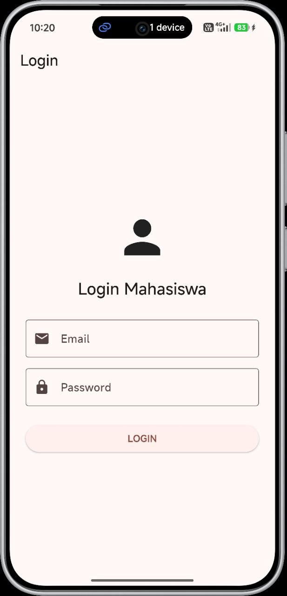
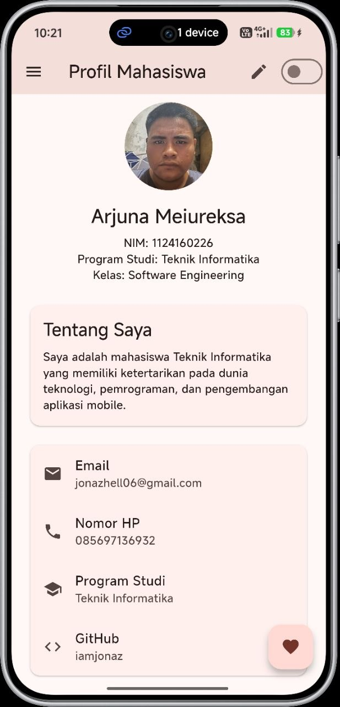
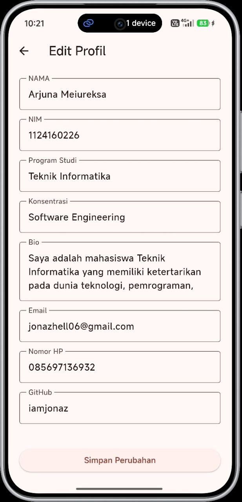
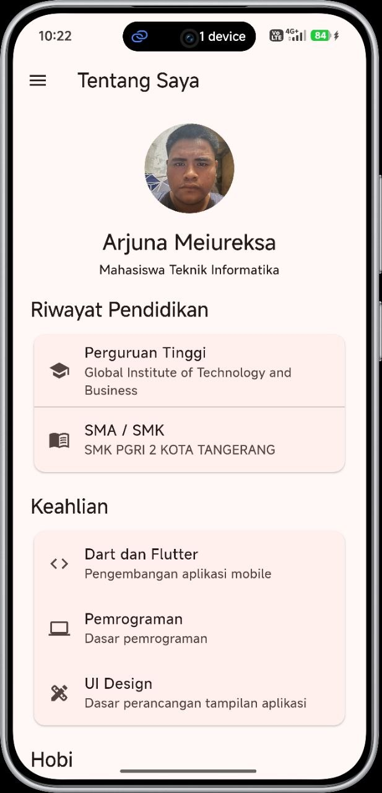
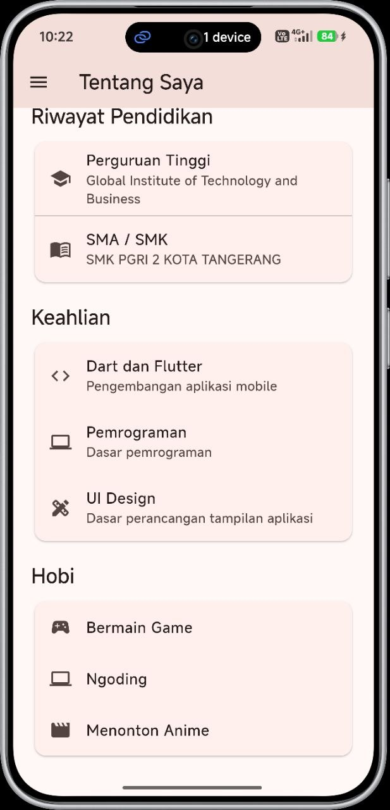
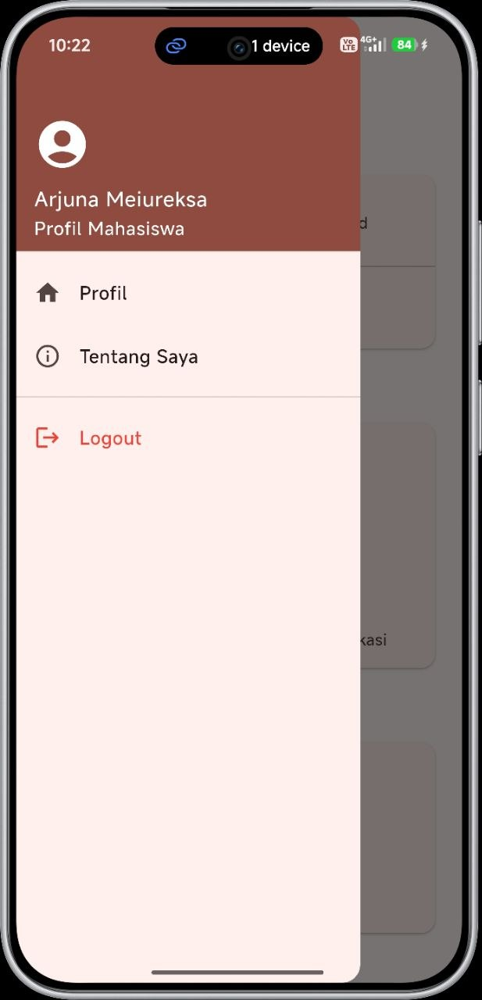

# Aplikasi Profil Mahasiswa

**UTS Pemrograman Mobile – Flutter**

## Identitas Mahasiswa

| Keterangan | Informasi |
|---|---|
| Nama | Arjuna Meiureksa |
| NIM | 1124160226 |
| Program Studi | Teknik Informatika |
| Kelas | Software Engineering |
| Mata Kuliah | Pemrograman Mobile |

## Deskripsi Aplikasi

Aplikasi Profil Mahasiswa merupakan aplikasi Android berbasis Flutter yang dibuat untuk menampilkan dan mengelola informasi pribadi mahasiswa.

Aplikasi ini memiliki empat halaman utama, yaitu Login, Profil, Edit Profil, dan Tentang Saya.

## Fitur Aplikasi

1. **Login:** Form login dengan validasi email, password, dan loading.
2. **Profil Mahasiswa:** Menampilkan foto, nama, NIM, program studi, kelas, bio, dan informasi kontak.
3. **Edit Profil:** Mengubah informasi mahasiswa dengan validasi input.
4. **Tentang Saya:** Menampilkan riwayat pendidikan, keahlian, dan hobi.
5. **Drawer Navigation:** Navigasi antarhalaman dan fitur Logout.
6. **Reusable Widget:** Menggunakan InfoTile untuk menampilkan informasi kontak.
7. **Light Mode dan Dark Mode:** Mengubah tema aplikasi secara langsung.
8. **Floating Action Button:** Menampilkan pesan menggunakan SnackBar.

## Screenshot Aplikasi

### 1. Halaman Login



### 2. Halaman Profil



### 3. Halaman Edit Profil



### 4. Halaman Tentang Saya




### 5. Halaman Drawer



## Teknologi yang Digunakan

- Flutter SDK
- Dart
- Material Design 3

## Struktur Folder

```text
soal2-profil-app/
├── assets/
│   └── images/
├── lib/
│   ├── main.dart
│   ├── theme_controller.dart
│   ├── models/
│   │   └── profile.dart
│   ├── screens/
│   │   ├── login_page.dart
│   │   ├── profile_page.dart
│   │   ├── edit_profilepage.dart
│   │   └── about_page.dart
│   └── widgets/
│       └── info_tile.dart
├── screenshots/
├── android/
└── pubspec.yaml
```

## Penyimpanan Data

Aplikasi menggunakan penyimpanan data sementara di dalam memori aplikasi (in-memory storage), tanpa menggunakan server atau database.

Data profil dikelola menggunakan class `Profile`. Perubahan data dilakukan melalui `TextEditingController`, kemudian dikirim kembali menggunakan `Navigator.pop(context, dataBaru)` dan ditampilkan ulang menggunakan `setState()`.

Data yang diubah hanya tersimpan selama aplikasi berjalan. Setelah aplikasi ditutup sepenuhnya, data akan kembali ke nilai awal.

## Cara Menjalankan Aplikasi

Pastikan Flutter SDK sudah terpasang.

Buka terminal pada folder proyek, kemudian jalankan:

```bash
flutter pub get
flutter run
```

Untuk menjalankan aplikasi langsung pada perangkat Android:

```bash
flutter devices
flutter run
```

## Build APK Release

Untuk membuat APK versi release, jalankan:

```bash
flutter build apk --release
```

File APK akan tersedia pada:

```text
build/app/outputs/flutter-apk/app-release.apk
```

## Download APK

Versi aplikasi: **v1.0.0**

Link GitHub Release:

[Tautan Download APK – v1.0.0](GANTI_DENGAN_LINK_RELEASE_LU)

## Video Presentasi

Judul video:

UTS PML – Aplikasi Profil – Arjuna Meiureksa – 1124160226

Link YouTube:

[Tautan Download APK – v1.0.0](GANTI_DENGAN_LINK_RELEASE_LU)

